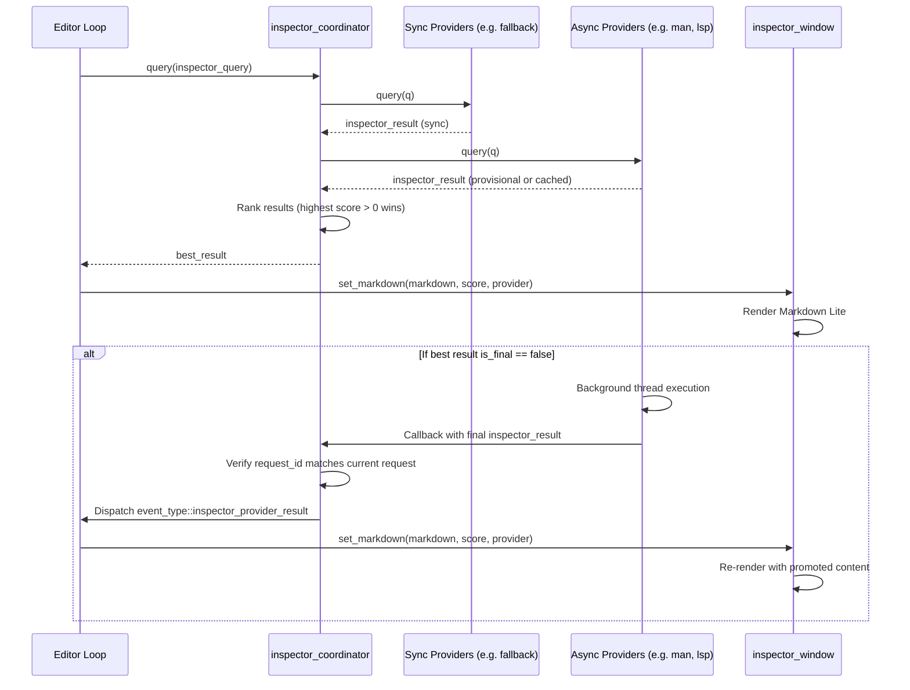

# Symbol Inspector Companion Window & Provider Architecture

Turbostar features an ambient, opt-in companion window docked at the bottom of the workspace (`Alt+I` / `Tools -> Symbol Inspector`). It provides live, context-aware intelligence for the symbol or call under the cursor—such as function signatures, argument hints, required `#include` headers, declaration locations, man page summaries, diagnostics, and AI suggestions.

This document describes the companion window architecture, the pluggable content provider pipeline, the Markdown Lite text rendering contract, scoring models, and guidelines for adding new providers.

---

## 1. Architectural Principles

1. **Decoupled Provider Architecture**:
   - Content providers reside in `src/inspector/` and are completely decoupled from ncurses, terminal APIs, and the UI rendering pipeline.
   - Providers take an `inspector_query` and produce an `inspector_result` formatted in Markdown Lite.

2. **Markdown Lite Text Contract**:
   - Providers do not draw widgets or return curses attributes; they return a standard markdown string.
   - The UI companion window (`src/ui/inspector_window.{h,cpp}`) owns all layout, line splitting, word wrapping/truncation, and Borland Pascal 7 color attribution.

3. **Dynamic Scoring & Graceful Degradation**:
   - Multiple providers can respond to the same query with an integer confidence score (0 to 100).
   - The provider with the highest score is displayed.
   - A score of `0` (`inspector_scores::INVALID`) indicates the provider has no meaningful data for the token and must never be rendered.

4. **Synchronous Fast Path & Non-Blocking Async Resolution**:
   - Providers can return immediately if data is cached or locally computable.
   - For expensive queries (LSP definitions, remote AI models, troff decompression), providers return a provisional result (`is_final = false`) and resolve on background worker threads.
   - Monotonic request IDs (`inspector_query::request_id`) ensure stale background responses from previous cursor positions are discarded automatically.

---

## 2. Directory Structure & Key Files

| File | Purpose |
|---|---|
| `src/ui/inspector_window.{h,cpp}` | Curses-based companion window: handles docking, borders, background, Markdown Lite parsing, and color pair styling. |
| `src/inspector/inspector_types.h` | Core data structures (`inspector_query`, `inspector_result`) and standardized score constants (`inspector_scores`). |
| `src/inspector/inspector_helpers.{h,cpp}` | `inspector::markdown_builder` fluent DSL for constructing Markdown Lite and formatting declaration locations. |
| `src/inspector/inspector_provider.h` | Abstract base class `inspector_provider` defining `query()` and `query_async()`. |
| `src/inspector/inspector_coordinator.{h,cpp}` | Central orchestrator: registers providers, queries them synchronously/asynchronously, and ranks results. |
| `src/inspector/fallback_provider.{h,cpp}` | Baseline provider: handles idle state and fallback token echoing (score 15). |
| `src/inspector/enclosing_class_provider.{h,cpp}` | Enclosing class provider: instant 0ms ambient context for the current function's class (score 34). |
| `src/inspector/class_summary_provider.{h,cpp}` | Focused symbol class provider: resolves class of the hovered token or variable via LSP (score 35). |
| `src/inspector/lsp_provider.{h,cpp}` | LSP and clangd provider: fast-path call synthesizer analysis, async signature queries, and declaration path confidence scoring. |
| `src/inspector/man_page_provider.{h,cpp}` | System man page provider: reads section 3 man pages (`/usr/share/man/man3/`), extracts clean prototypes, headers, and descriptions. |

---

## 3. Data Structures & Scoring Model

### Data Structures (`src/inspector/inspector_types.h`)

```cpp
struct inspector_query {
	uint64_t request_id{0};     ///< Monotonic sequence ID
	std::string file_path;      ///< Active document path
	int line{0};                ///< 0-based document line
	int col{0};                 ///< 0-based document column
	std::string token;          ///< Identifier / symbol under the cursor
	int available_lines{3};     ///< Number of usable content lines in companion window
};

struct inspector_result {
	std::string provider_name;  ///< Identifier of the responding provider
	int score{0};               ///< Confidence score (0..100). 0 = INVALID
	std::string markdown;       ///< Markdown Lite formatted payload
	std::string title_addon;    ///< Optional addon rendered in the window title bar
	bool is_final{true};        ///< False if background async resolution is in progress
};
```

### Standardized Scoring Tiers (`inspector_scores`)

| Constant | Value | Description |
|---|---|---|
| `INVALID` | `0` | Negative hit or no data. Filtered out; never displayed. |
| `RESOLVING_HINT` | `10` | Provisional hint while an async provider resolves in background. |
| `FALLBACK_TOKEN` | `15` | Default fallback echoing the token name under cursor. |
| `LSP_FALLBACK_TOKEN` | `20` | Synthesized fallback from AST when LSP definition is absent. |
| `CLASS_ENCLOSING` | `34` | Enclosing class overview (instant 0ms ambient context for surrounding function/blank lines). |
| `LOCAL_SYMBOLS` | `40` | Tag / local symbol table match. |
| `GIT_BLAME` | `50` | Git blame / author attribution information. |
| `LSP_LOW_CONFIDENCE`<br>`LSP_SYSTEM_HEADER` | `70` | LSP resolved to `/usr/include/` system headers or missing an actual project path. |
| `MAN_PAGE` | `80` | Authoritative section 3 system manual page (`/usr/share/man/man3/`). |
| `LSP_RESOLVED` | `85` | Verified project / workspace symbol definition from LSP (for non-member / external calls). |
| `CLASS_ENCLOSING_MEMBER` | `90` | Enclosing class summary with focused member declaration (beats LSP). |
| `CLASS_TOKEN` | `91` | Class overview for focused token or variable under cursor (beats LSP). |
| `DIAGNOSTIC_WARNING` | `95` | Linter or compiler diagnostic warning on the current symbol. |
| `DIAGNOSTIC_ERROR` | `98` | Compiler diagnostic error on the current symbol. |

### Rationale: Man Page (80) vs. System LSP (70)

When inspecting standard C library functions (e.g. `qsort`, `printf`, `malloc`):
- Clangd/LSP locates the declaration inside glibc internal headers (`/usr/include/stdlib.h`, `/usr/include/bits/...`).
- The raw LSP signature frequently contains noisy glibc internal macros (`__compar_fn_t`, `__restrict`, `__nonnull`, `__wur`).
- Conversely, section 3 manual pages provide standardized, clean prototypes, specify the exact `#include <stdlib.h>` required, and include concise human-readable summaries.
- Therefore, when `lsp_inspector_provider::has_actual_project_path()` detects a system header (`/usr/` or `/opt/`) or fails to find a file path, LSP scores **70**, allowing `man_page_provider` (**80**) to win.
- For foreign/external project functions (e.g. `fs_utils::read_file`), LSP scores **85**, beating ambient enclosing class (34).
- When inspecting a class member or instance variable, rich class summaries (`CLASS_ENCLOSING_MEMBER` = **90** and `CLASS_TOKEN` = **91**) beat LSP (**85**) to present complete type declarations alongside class context.

---

## 4. Lifecycle & Asynchronous Pipeline



### Stale Request Invalidation
As the user navigates across lines or words, queries are generated rapidly:
1. `inspector_coordinator::next_request_id()` monotonically increments `request_id`.
2. When a background thread completes, `inspector_coordinator` compares the result's `request_id` against `active_request_id_`.
3. If the user has moved to a new token, stale background responses are discarded silently without redrawing the UI.

---

## 5. Markdown Lite Specification & UI Rendering

The companion window parses Markdown Lite using a specialized single-pass scanner in `src/ui/inspector_window.cpp`. The layout uses the Turbo Pascal 7 color palette:

| Markdown Syntax | Element | Rendered Colors |
|---|---|---|
| `**Label:**` | Field Header (`Signature:`, `Header:`, `Decl:`, `Summary:`) | Bright White on Cyan (`COLOR_PAIR(8) \| A_BOLD`) |
| `` `code` `` | Code / Signatures / Header files | Bright Yellow on Cyan (`COLOR_PAIR(18) \| A_BOLD`) |
| `[text](url)` | Links / References (e.g. `[man 3 qsort](man:qsort)`) | Bright White on Cyan (`COLOR_PAIR(8) \| A_BOLD`) |
| `1. `, `2. ` | Numbered argument hints | Bright Yellow on Cyan (`COLOR_PAIR(18) \| A_BOLD`) |
| `*text*` | Italic / Annotations | Cyan background (`COLOR_PAIR(17) \| A_UNDERLINE`) |
| Plain text | Explanations, summaries | Black on Cyan (`COLOR_PAIR(17)`) |

### Standard Field Layout & Window Title Addons

To fit comfortably inside a 4-to-6 line companion window (which provides 2 to 4 content lines), providers adhere to a standard 2-to-3 line layout:

```markdown
**Signature:** `void qsort(void *base, size_t nmemb, size_t size, int (*compar)(const void *, const void *));`
**Header:** `<stdlib.h>`
**Summary:** Sort an array.
```

- **Title Bar**: The companion window top border displays `Inspector: <provider> (<score>) - <title_addon>` (e.g. `Inspector: man_pages (80) - man 3 qsort` or `Inspector: lsp (90) - src/editor.cpp:42`). This moves location / origin details out of the content body to save vertical real estate.
- **Line 1**: Primary signature or expression type.
- **Line 2**: Relevant header file(s) (if applicable).
- **Line 3**: Human-readable summary or diagnostics.

---

## 6. Built-in Providers

### 1. `man_page_provider` (`src/inspector/man_page_provider.h`)
- **Coverage**: Reads standard C and POSIX library manual pages from `/usr/share/man/man3/`.
- **Decompression**: Automatically detects and streams `.3.gz` (via `zlib`/`gzread`) and `.3` uncompressed files.
- **Redirects**: Follows `.so man3/target.3` redirection directives.
- **Prototype Extraction**: Converts troff to clean markdown via `troff2md()`, isolates the queried function signature with balanced parenthesis matching (ignoring semicolons inside parameter comments or nested function pointers), and collapses multi-line whitespace.
- **Header Extraction**: Parses the `SYNOPSIS` section for `#include <...>` directives. For shared multi-function man pages (e.g. `warn.3`), scopes search to headers preceding the queried function.
- **Two-Tier Caching**:
  - Positive cache: parsed prototypes, headers, and summaries.
  - Negative cache: records symbols not found in `man3/` to eliminate repeated filesystem stats.

### 2. `lsp_inspector_provider` (`src/inspector/lsp_provider.h`)
- **Fast Path**: Queries `turbostar::call_synthesizer::analyze_context_at()` synchronously. If the symbol or call context is already cached or local, returns immediately with score `90`.
- **Async Path**: Dispatches background definition and signature queries via `tools::resolve_function_signature()`.
- **Path Verification**: Uses `has_actual_project_path()` to inspect `declaration_location`. If missing, compiler-generated, or inside `/usr/` or `/opt/`, scores `70` (`LSP_SYSTEM_HEADER`). If pointing to a workspace file, scores `90` (`LSP_RESOLVED`).

### 3. `enclosing_class_provider` (`src/inspector/enclosing_class_provider.h`)
- **Score**: `34` (`CLASS_ENCLOSING`) for ambient context (blank lines, braces), promoting to `90` (`CLASS_ENCLOSING_MEMBER`) when cursor rests on an enclosing class field or method (beating LSP).
- **Behavior**: Purely synchronous (0ms latency). Queries the local file codemap at cursor line (`q.line + 1`) to provide immediate ambient overview of the current function's enclosing class methods and fields.
- **Title Bar**: Emits `title_addon` (e.g. `class editor (src/editor.h)`), saving vertical space in the content body by eliminating a redundant `Class:` line.
- **Focused Member Declaration**: If the symbol under cursor matches an enclosing class field or method, the provider extracts and displays its full type declaration or function signature (e.g. `**Field:** `std::vector<...> lines_;`` or `**Method:** `bool save();``) directly from the header lines.

### 4. `class_summary_provider` (`src/inspector/class_summary_provider.h`)
- **Score**: `91` (`CLASS_TOKEN`).
- **Behavior**: Asynchronous resolution via background LSP type definition queries (`lsp_query_type_definition` / `lsp_query_definition`). When cursor rests on a specific type name or variable instance (e.g. `doc`), resolves the class definition and promotes over the enclosing class and single-symbol LSP definitions.
- **Adaptive Height**: Automatically formats output across 2, 3, or 4 lines according to `q.available_lines`. Omits the redundant `Class:` line to maximize density.
- **Title Bar**: Emits `title_addon` (e.g. `class document (src/document.h)`).

### 5. `fallback_inspector_provider` (`src/inspector/fallback_provider.h`)
- **Score**: `15` (`FALLBACK_TOKEN`).
- **Behavior**: If the cursor is on whitespace or an empty line, returns score `0` (`INVALID`) with `*[No symbol under cursor]*`. If over an identifier, echoes the token in code formatting (`` `token` ``).

---

## 7. How to Add a New Provider

To implement an additional provider (e.g. Python docstring inspector, git blame inspector, or external AI inspector):

1. **Subclass `inspector_provider`**:
   Create `src/inspector/my_provider.h` and `.cpp`:
   ```cpp
   #pragma once
   #include "inspector/inspector_provider.h"

   class my_inspector_provider : public inspector_provider
   {
   public:
       std::string_view name() const noexcept override { return "my_provider"; }
       inspector_result query(const inspector_query &q) override;
       void query_async(const inspector_query &q, std::function<void(inspector_result)> callback) override;
   };
   ```

2. **Implement `query()` and `query_async()`**:
   Use `inspector::markdown_builder` to generate formatted markdown:
   ```cpp
   inspector_result my_inspector_provider::query(const inspector_query &q)
   {
       inspector_result res;
       res.provider_name = name();
       if (q.token.empty()) {
           res.score = inspector_scores::INVALID;
           return res;
       }

       inspector::markdown_builder mb;
       mb.header("Summary:").text("Custom provider details for ").code(q.token);
       res.markdown = mb.build();
       res.score = inspector_scores::LOCAL_SYMBOLS; // Or appropriate tier
       res.is_final = true;
       return res;
   }
   ```

3. **Register in `editor::init_inspector()`**:
   In `src/editor.cpp`, instantiate and register the provider with `inspector_coordinator`:
   ```cpp
   coordinator_->register_provider(std::make_unique<my_inspector_provider>());
   ```

4. **Add Markdown and Unit Tests**:
   - Create `src/inspector/my_provider.md` with goals, constraints, and lessons learned.
   - Add unit tests in `tests/unit/test_my_provider.cpp` and register in `tests/meson.build`.
